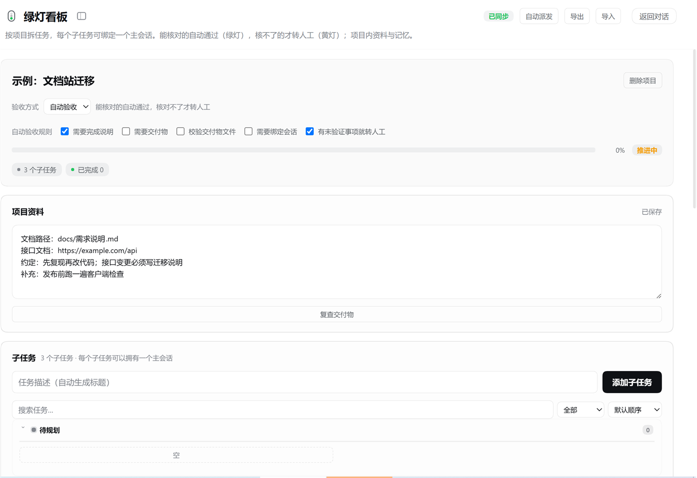
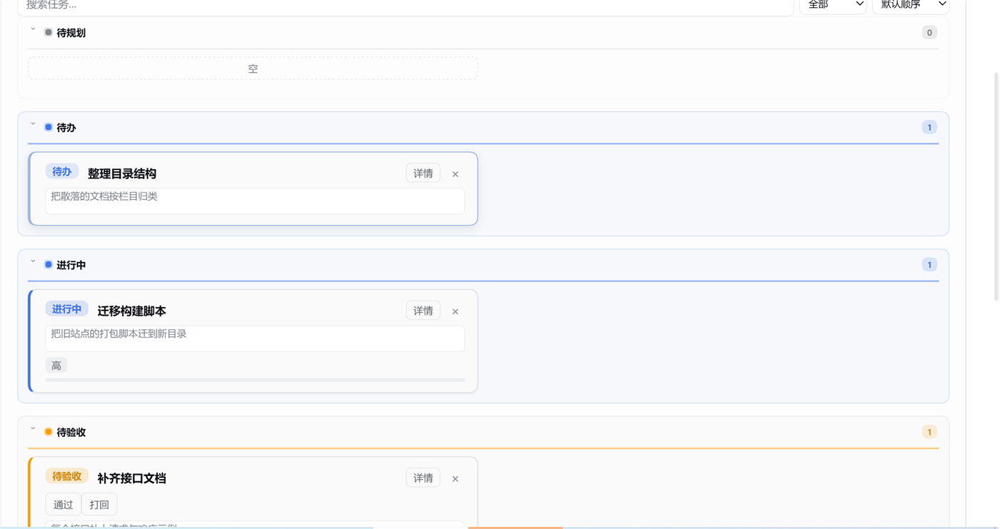
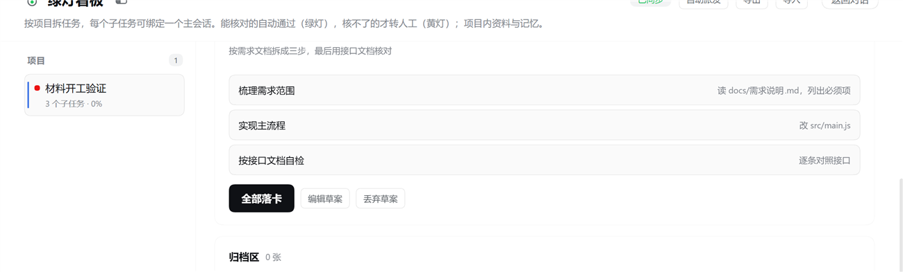
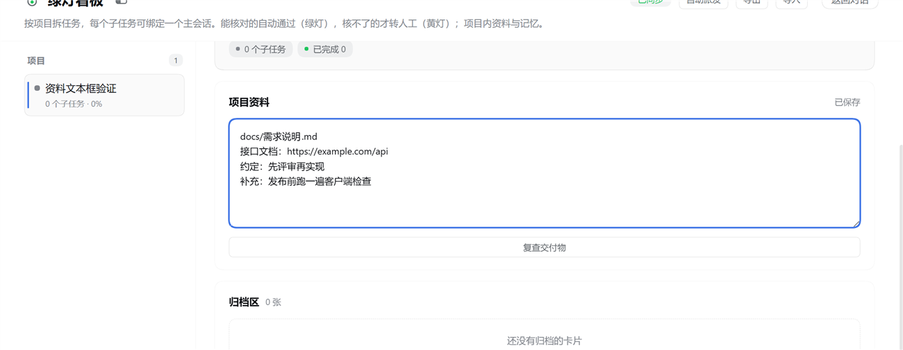

[](https://www.npmjs.com/package/dsh-greenlight)
[](https://www.npmjs.com/package/dsh-greenlight)
[](./LICENSE)
[](https://github.com/deepseek-ai/deepseek-harness)

English | [简体中文](./README.md)

# Greenlight — an acceptance board

> **What can be checked closes itself. What cannot asks a human.**
> A project board with an acceptance judgement: cards prove their own completion, and you only look at the ones that cannot.

A DeepSeek Harness plugin. It adds a Greenlight board to the left sidebar: work splits into
projects and subtasks, each subtask can own a main Session, and when an agent submits through
the `greenlight_*` tools it reports **a completion note, verification claims and deliverables** —
the Host decides whether the card may close.









## Why "green light"

Most boards push every acceptance decision to a human: the agent says "done" and someone has to
open each card and judge. Greenlight inverts that.

| Situation | Outcome |
|---|---|
| Claims complete, deliverables really exist, required layers covered | **auto-accepted** (green), no human needed |
| Deliverables missing/empty, layers uncovered, a failing claim, or human mode | **escalated** (amber) with the exact reason |

Humans stop reviewing everything and start handling exceptions. That is the green light.

## Features

**Acceptance**
- **Real deliverable checks** — the Host probes the disk before committing; relative paths resolve
  against the project root, and directories or empty files count as missing
- **Verification layers** — `static` / `unit` / `build` / `host` / `device`; a project can require
  specific layers, and an uncovered layer blocks auto-acceptance
- **Claims** — `{ what, how, layer, outcome }`; a `pass` only counts when "how" is filled in, and a
  `fail` blocks the card
- **Configurable rules** — require evidence / require deliverables / verify deliverables on disk /
  require a Session / require a verified claim
- **Verification debt** — anything still unverified is recorded and visible, not silently dropped
- **Column gates** — optionally refuse to move a card into review without evidence or deliverables
- **Warnings vs blockers** — small gaps surface as notes instead of dumping every card on a human

**Start from materials**
- Real work arrives as source trees, requirement docs, API docs and a few links: they are one block
  of text in Project materials — paste it and it saves
- The agent reads that block, then hands over a **draft plan** through `greenlight_plan_set`
  (a proposal, no cards yet)
- The draft is editable (summary, titles, notes, remove or add rows); cards are created only when a
  human presses create, and an edit keeps the deliverables and priority the agent attached

**Context**
- Projects → subtasks, each subtask bindable to one main Session, one-click dispatch
- Project **materials** are a single multi-line text block (doc paths, conventions and links all live
  there, saved as you type) plus project memory
- **Decision anchor** — requirement digest, key decisions, open risks, deviations, reused across sessions
- **Next action** per card, reused as the opening line of a dispatch prompt

**Traceability**
- Card history: moves, acceptances, escalations, claims, reviews
- Independent review records stored next to the card instead of buried in chat
- **Preview** — dry-run a batch of operations and see what would change, writing nothing

**Everyday use**
- Six columns with drag and drop, search/filter, priority, due date, tags, templates
- 8-second undo and a 7-day trash; every delete, archive, import and purge asks first
- Archive to a separate cold-storage file, restorable at any time
- Chinese and English UI, SSE live updates, JSON import/export

## Install

```bash
dsh plugin --profile web add dsh-greenlight
```

Or straight from npm (the same package; enable it on the Plugins page):

```bash
npm i dsh-greenlight
```

Restart `dsh web` and refresh. The sidebar shows **绿灯看板 / Greenlight Board**. No token, no API key,
no database.

## Quick start

1. Create a project, then add a card by describing the work (the title is derived and editable).
2. Dispatch the card to a Session, or tell the agent to work on it. The agent submits:

```text
greenlight_task_submit {
  projectId, taskId,
  evidence: "what changed and how it was checked",
  claims: [{ what: "unit tests pass", how: "node --test 93", layer: "unit", outcome: "pass" }],
  deliverables: ["docs/report.md"],
  nextAction: "awaiting review"
}
```

3. If the evidence holds and the deliverables exist, the card closes itself. Otherwise it lands in
   **待验收 / review** with the reason spelled out, and a human decides.

## Agent tools (16)

| Tool | Purpose |
|---|---|
| `greenlight_overview` | Board overview: projects, counts, cards needing attention |
| `greenlight_project` | One project: tasks, materials text, draft plan, acceptance rules, anchor |
| `greenlight_materials` | Write the project **materials text** (doc paths, conventions and links all live in this one block) |
| `greenlight_plan_set` | Write a **draft plan** (creates no cards) for a human to confirm |
| `greenlight_plan_apply` | Turn the draft into real subtasks (duplicate titles skipped) |
| `greenlight_task_create` | Create a card (title, description, priority, due date, tags) |
| `greenlight_task_update` | Update a card: status, progress, note, blocked, evidence, deliverables, next action |
| `greenlight_task_submit` | **Deliver**: evidence + claims + deliverables, judged by the Host |
| `greenlight_acceptance` | Read/write project acceptance mode, rules, required layers, root dir |
| `greenlight_preview` | Dry-run operations, returns the changes, writes nothing |
| `greenlight_recheck` | Re-probe deliverables, flag the ones that went missing |
| `greenlight_review` | Record an independent review (verdict, note, author) |
| `greenlight_archive` | Cold storage: list / archive / restore finished cards |
| `greenlight_memory_add` | Append project memory |
| `greenlight_session_attach` | Bind a card to a main Session |
| `greenlight_trash` | Trash: list / restore / purge |

## Acceptance rules

| Rule | Default | Meaning |
|---|---|---|
| `requireEvidence` | on | A completion note is required |
| `requireDeliverables` | off | At least one deliverable must be declared |
| `verifyDeliverables` | on | Declared deliverables must exist on disk |
| `requireSession` | off | The card must own a Session |
| `requireVerifiedClaim` | off | At least one passing claim with a method |
| `blockOnDebt` | on | Anything unverified or undecided sends the card to a human (the agent declares it through `pendingVerification`) |
| `requiredLayers` | none | Verification layers the completion must cover |
| `rootDir` | none | Base directory for relative deliverables |

Auto-acceptance requires: automatic mode, no per-card human flag (the card's own "needs my
acceptance" switch), progress at 100%, not blocked, not failed, and every enabled rule satisfied.
Any gap escalates with a concrete reason.

## Data

| Item | Location |
|---|---|
| Board document | `$DSH_HOME/greenlight/board.json` (default `~/.dsh/greenlight/board.json`) |
| Archive | `board-archive.json` beside it |
| Write discipline | temp file → `fsync` → read-back compare → atomic rename; a corrupt file is set aside, never overwritten |

The Host owns the document and the browser keeps a mirror, so it survives restarts and other browsers.

## FAQ

**Can an agent close its own card?** Yes, but only when verification passes. `greenlight_task_submit`
always goes through acceptance; a human moving the card is recorded as a human acceptance.

**Do I need a project root?** Recommended when using relative deliverable paths. Without it, relative
paths cannot be located — the card escalates with "cannot locate deliverable" instead of pretending.

**Can I turn auto-acceptance off?** Yes: set the project to human acceptance.

**How is this different from `dsh-taskboard`?** That plugin keeps `done` permanently human-only.
Greenlight lets the machine judge first and shows humans only the exceptions.

## Development

```bash
npm test              # host tests (95 pass, 3 socket cases skip when loopback is blocked)
npm run test:client   # client render checks (317, no browser needed)
```

Mount locally with `dsh plugin --profile web add "link:D:/Projects/dsh-greenlight"`.

Releasing and getting listed (npm publish, the four community markets, the source
fields): see [docs/PUBLISHING.md](./docs/PUBLISHING.md).

## License

[MIT](./LICENSE)
