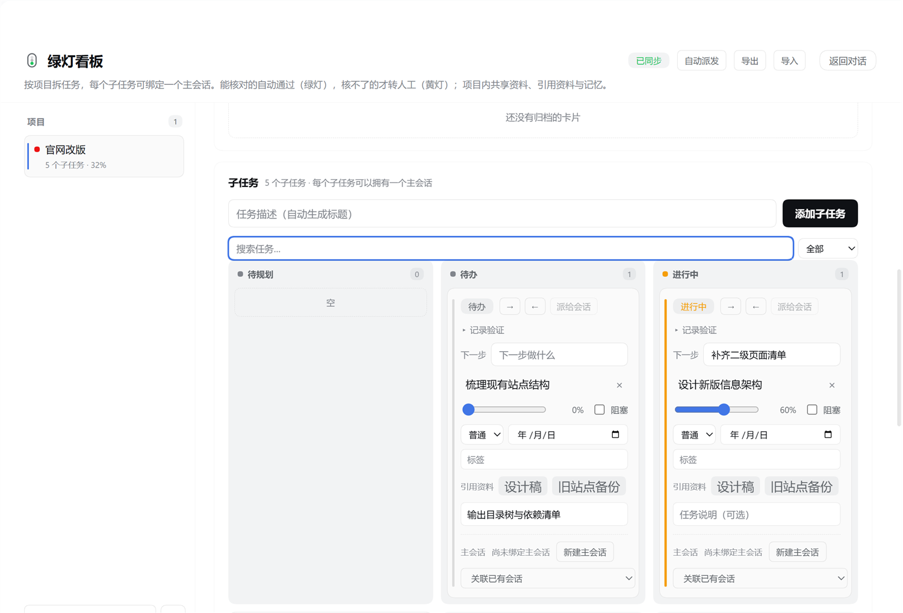

[](https://www.npmjs.com/package/dsh-greenlight)
[](./LICENSE)
[](https://github.com/deepseek-ai/deepseek-harness)

[English](./README.en.md) | 简体中文

# Greenlight · 绿灯看板

> **能核对的自动通过，核不了的才找人。**
> 一个带验收判断的项目看板：卡片自己证明完成，人只看证明不了的那几张。

DeepSeek Harness 插件。左栏增加「绿灯看板」入口：按项目拆分任务、每个子任务绑定一个主会话，
agent 用 `greenlight_*` 工具交活时附上**完成说明 / 验证项 / 交付物**，由 Host 判定是否放行。



## 为什么叫「绿灯」

大多数看板把所有验收都推给人：agent 说完成了，人得逐张点开判断。Greenlight 反过来——

| 情况 | 结果 |
|---|---|
| 证据齐、交付物真实存在、验证层级覆盖够 | **自动通过**（绿灯），人不用管 |
| 交付物缺失/为空、验证层级不够、有失败项、明确要求人工 | **转人工**（黄灯），并写明原因 |

人从"逐张验收"变成"只看例外"。这就是绿灯的含义，也是它和别的看板最大的区别。

## 功能

**验收判断（核心）**
- **交付物真实校验**：Host 在落盘前真的去磁盘上探，相对路径按项目根目录解析；目录、空文件一律算缺失
- **验证层级**：`static` 静态 / `unit` 单测 / `build` 构建 / `host` 本机 / `device` 真机｜项目可声明 `requiredLayers`，未覆盖不放行
- **验证项 claims**：每条 `{ 验证了什么, 怎么验证的, 层级, 结论 }`；`pass` 且写了"怎么验证的"才算覆盖，`fail` 直接阻断
- **可配置验收规则**：需要完成说明 / 需要交付物 / 校验交付物文件 / 需要绑定会话 / 需要至少一条验证项
- **验证债**：还没验证的事项显式记账，卡片和项目里都能看到
- **阶段闸**：项目可要求"进待验收前必须有完成说明/交付物"，闸门前移到每列拐点
- **验收分级**：阻断原因与提示分离，小问题只提示、不把整张卡丢给人

**协作与上下文**
- 项目 → 子任务两级；每个子任务可绑定一个主会话，支持一键派活
- 项目级**共享资料**、**引用资料**（可写文档路径/链接，失效自动标 ⚠ 已失效）、**项目记忆**
- **决策锚点**：需求摘要 / 关键决策 / 未解决风险 / 计划偏离，跨会话复用不再重读全文
- **下一步**：每张卡写"接下来做什么"，派活提示词直接沿用

**可追溯**
- 卡片**轨迹**：移动、验收、转人工、验证项、复评都有记录
- **独立复评**：第二意见记在卡片旁边，而不是散在聊天里
- **预览干跑**：agent 可先试一组操作会带来什么变化，不落盘

**日常使用**
- 六列看板 + 拖拽流转、搜索/筛选、优先级/截止/标签、任务模板
- **撤销**（8 秒）与**回收站**（7 天）；所有删除、归档、导入、清空都要二次确认
- **归档区**：完成的卡移入独立冷存储文件，可随时恢复
- 中英双语界面、SSE 实时刷新、JSON 导入导出

## 安装

```bash
dsh plugin --profile web add dsh-greenlight
```

安装后**重启 `dsh web` 并刷新页面**，侧边栏出现「绿灯看板」即成功。无需 Token、无需 API Key、无需数据库。

> 官方 `@deepseek-ai/dsh-*` 包只写进 profile 的 `bundles` 列表；第三方插件按上面的 `plugin add` 安装即可。

卸载：`dsh plugin --profile web remove dsh-greenlight`（看板数据保留在数据目录，见下）。

## 快速开始

**1. 建项目、建卡**：左栏「+ 新建项目」→ 项目内输入任务描述（标题自动生成，可改）。

**2. 让 agent 干活**：把卡片「派给会话」，或直接在会话里说"做看板上的 xxx 任务"，agent 会调用工具：

```text
greenlight_overview                                  # 看板概览
greenlight_project        { projectId }              # 读项目（含验收规则与锚点）
greenlight_task_update    { projectId, taskId, ... } # 认领、改进度、写下一步
…… 真正干活 ……
greenlight_task_submit {
  projectId, taskId,
  evidence: "改了什么、怎么验的",
  claims: [{ what: "单测通过", how: "node --test 93 项", layer: "unit", outcome: "pass" }],
  deliverables: ["docs/report.md"],
  nextAction: "等复核"
}
```

**3. 看结果**：证据齐、交付物真实存在时卡片**自己进「已完成」**；否则落到「待验收」并写明原因，人再决定通过或打回。

## Agent 工具（15 个）

| 工具 | 作用 |
|---|---|
| `greenlight_overview` | 看板总览：项目、计数、需要处理的卡片 |
| `greenlight_project` | 读单个项目：任务、共享资料、验收规则、锚点 |
| `greenlight_task_create` | 建卡（标题、描述、优先级、截止、标签） |
| `greenlight_task_update` | 改卡：状态/进度/备注/阻塞/完成说明/交付物/下一步 |
| `greenlight_task_submit` | **交付**：完成说明 + 验证项 + 交付物 + 进度，由 Host 判定 |
| `greenlight_acceptance` | 读写项目验收方式与规则（自动化程度、层级要求、根目录） |
| `greenlight_preview` | 干跑一组操作，返回将发生的变化，不写盘 |
| `greenlight_recheck` | 复查引用与交付物是否还有效，失效的打标记 |
| `greenlight_review` | 记录一次独立复评（结论 + 说明 + 由谁） |
| `greenlight_archive` | 冷存储：列出 / 归档 / 恢复已完成卡片 |
| `greenlight_memory_add` | 追加项目记忆 |
| `greenlight_shared_set` | 设置项目共享资料正文 |
| `greenlight_shared_entry` | 管理引用资料（增删改、列表） |
| `greenlight_session_attach` | 把卡片绑定到主会话 |
| `greenlight_trash` | 回收站：列出 / 恢复 / 清空 |

## 验收规则一览

项目级配置（界面「自动验收规则」或 `greenlight_acceptance`）：

| 规则 | 默认 | 作用 |
|---|---|---|
| `requireEvidence` | 开 | 必须有完成说明 |
| `requireDeliverables` | 关 | 必须声明交付物 |
| `verifyDeliverables` | 开 | 声明的交付物必须真实存在（关掉则只当元数据） |
| `requireSession` | 关 | 必须绑定主会话 |
| `requireVerifiedClaim` | 关 | 至少一条带"怎么验证的"的通过项 |
| `requiredLayers` | 空 | 必须覆盖的验证层级 |
| `rootDir` | 空 | 相对交付物的解析根目录 |

自动通过的完整条件：非人工模式、非"需人工"卡片、进度 100%、未阻塞、未失败，且以上规则全部满足。
任一不满足 → 转人工，并在卡片上写明**具体原因**（例如"交付物不存在或为空：docs/report.md"）。

## 数据与存储

| 项 | 位置 |
|---|---|
| 看板文档 | `$DSH_HOME/greenlight/board.json`（默认 `~/.dsh/greenlight/board.json`） |
| 归档（冷存储） | 同目录 `board-archive.json` |
| 写入纪律 | 临时文件 → `fsync` → 回读比对 → 原子 rename；文件损坏自动另存备份，不覆盖原文件 |

- Host 持有权威文档，浏览器只是镜像，所以换浏览器/重启都在
- 相对交付物按项目「根目录」解析；没设根目录时不猜，直接转人工
- 想换位置：在 `cordis.patch.yml` 的插件行配置 `boardFile`

## 常见问题

**agent 能把卡片自己标成「已完成」吗？**
能，但**只有在核对通过时**。`greenlight_task_submit` 永远走验收：证据齐、交付物真实存在、层级够才自动完成，否则转人工。人手动移动的卡则记为"人工通过"。

**交付物一定要设项目根目录吗？**
写相对路径时建议设。没设根目录时，相对路径无法定位，会一律转人工（原因里写明"无法定位交付物"），不会假装校验过。

**能完全不自动通过吗？**
能。项目验收方式切到「人工验收」，所有卡都要人点头。

**浏览器关了还跑吗？**
看板是状态面板，不跑后台任务；已派活的会话在 DSH 里继续跑，跑完通过工具回报。

**和 `dsh-taskboard` 有什么区别？**
后者把 done 永久锁给人类；Greenlight 让**机器先判、人只看例外**。喜欢"全部人工验收"用前者，想减少无意义点卡用后者。

**数据会不会丢？**
写入是原子 + fsync + 回读校验，损坏文件会被另存而不是覆盖。另外有 8 秒撤销和 7 天回收站。

## 开发

```bash
npm test          # 宿主单测（93 项）
npm run test:client   # 客户端渲染检查（259 项，无浏览器）
```

本地挂载：

```bash
dsh plugin --profile web add "link:D:/Projects/dsh-greenlight"
```

改动客户端后刷新页面；改动宿主侧后重启 `dsh web`。

## 兼容

- DeepSeek Harness ≥ `0.2.2-rc.3`
- Node.js ≥ 24.9.0
- 无原生依赖、无构建步骤、无网络请求

## License

[MIT](./LICENSE)